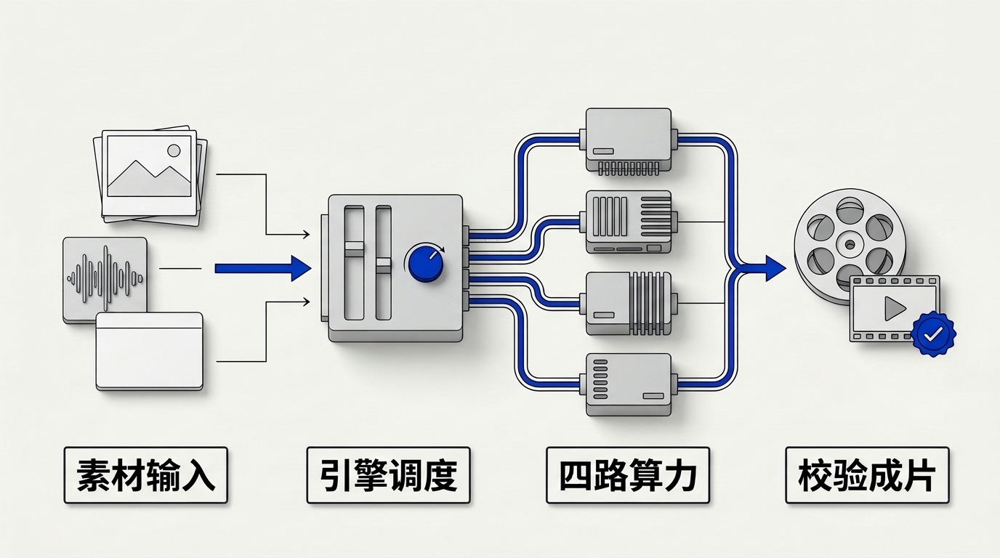
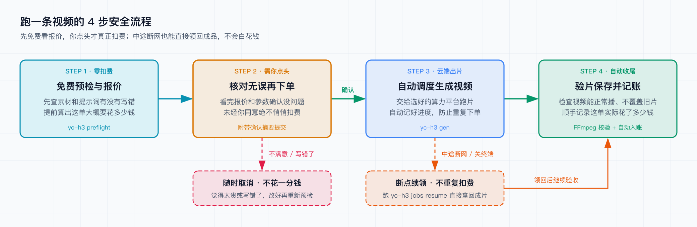

<div align="center">


# yc-h3-engine

**MiniMax-H3 多通道底层生视频引擎（CLI `yc-h3` + 配套 Agent Skill）**

<p align="center"><a href="LICENSE"></a> <a href="pyproject.toml"></a> <a href="#四个通道怎么选"></a> <a href="#四个通道怎么选"></a> <a href="skills/yc-h3-engine/SKILL.md"></a></p>

<p align="center">
  
</p>

[**四个通道怎么选**](#四个通道怎么选) · [**安装**](#安装) · [**让 Agent 帮你配**](#让你的-agent-帮你装和配) · [**账号与 `.env` 配置**](#env-config) · [**跑通第一条视频**](#quickstart) · [**实测速度与费用**](#我实测下来的速度和费用) · [**协议与致谢**](#协议与致谢)

</div>

---

这是我从自己日常用的创作工作台里单独抽出来开源的 **MiniMax-H3 底层生视频引擎**（命令行 `yc-h3` + 配套 Agent Skill `skills/yc-h3-engine/`）。

我刻意让它只干一件事：**拿到素材和提示词 → 先免费预检和报价 → 你确认后再提交 → 成片自动做解码校验、绝不覆盖旧文件 → 顺手记好断点和费用台账**。它不绑死任何剧本、生图或剪辑流程，你可以直接挂进自己现有的项目里用。

- **Windows 10/11 / macOS / Linux 原生可用**：RunningHub、晨羽按次 API、晨羽独占 GPU，加上配置向导、环境体检、断点恢复和费用台账，全平台都能直接跑。
- **Colab 通道**：1.0 支持 **macOS / Linux / Windows WSL2**（在原生 Windows 终端下调 Colab 会直接拦截，提醒你改用原生通道或进 WSL2）。
- **四个后端统一两套工作流名**：对外一律用 **`jinyu-hybrid`**（文戏，默认）和 **`jinyu-combat`**（武打），切换平台不用重新记工作流名；如果你想接自己的工作流，可以看 [docs/ADDING_WORKFLOW.md](docs/ADDING_WORKFLOW.md)。

---

## 四个通道怎么选

| 推荐怎么选 | 通道 (`--provider`) | 系统支持 | 素材上限 | 适合什么情况 |
| :--- | :--- | :--- | :--- | :--- |
| **新手首选（填 Key + 副本 ID 就能跑）** | `runninghub` | Win / macOS / Linux | 6 图 + 3 音 + 1 视频（视频伴音占音频槽，音/视频各限累计 15s） | 48GB Plus 云端托管，不用管 GPU 运维，支持参考视频和自定义 seed/steps |
| **高性价比 / 5090 按次出片** | `chenyu` | Win / macOS / Linux | 9 图 + 3 音（无视频，音频累计 ≤ 15s） | 5090 纯推理快（5s–11s 仅 2.2–4.8 min）且单价低（公开价约 ¥0.29–¥0.61/单），填 Key 免复制即用；2026-11-24 实测内容审查排队约 20–30+ min（平台持续优化中），暂不支持参考视频 |
| **连续批跑 / 独占 GPU 复用权重** | `chenyu-comfy` | Win / macOS / Linux | 9 图 + 3 音 + 3 视频（合计 ≤ 12，视频伴音占音频与总量槽且共用 15s 音频上限） | 晨羽独占 GPU，和 `chenyu` 共用同一个 API Key 和钱包，全平台纯 HTTPS 不用折腾 SSH，支持存私有镜像复用环境 + 持久盘复用权重 |
| **手里有 Colab Pro+ 额度** | `colab-comfy` | macOS / Linux / WSL2 | 9 图 + 3 音 + 3 视频（合计 ≤ 12，视频伴音占音频与总量槽且共用 15s 音频上限） | 托管 Google Colab（优先 G4 96GB / H100 / A100），适合已有 CU 额度时批量出片 |

> 各通道更细的耗时、显存、样本量和费率口径都整理在 [docs/BENCHMARKS.md](docs/BENCHMARKS.md)。
>
> **按自己习惯排优先级**：你可以在 `.env` 里配一行 `YC_H3_PROVIDER_ORDER` 自定义通道顺位（比如我自己在工作台里习惯 `colab-comfy,runninghub,chenyu-comfy,chenyu`，也可以只写你想用的那几个）。全局 `~/.yc-h3-engine/.env` 管日常默认，具体项目的 `./.env` 还能单独覆盖；命令行省略 `--provider` 自动选路和 Agent 帮你挑通道都会认这个顺位（首选没卡时 Agent 会先问你确认，再按下一顺位切）。

---

## 安装

### 先装两个基础依赖

1. **Python 3.12+** 和 **[uv](https://docs.astral.sh/uv/)**（用来隔离环境和一行安装）。
2. **FFmpeg / FFprobe**（用来给成片做 24fps / 双声道 / `-xerror` 解码校验，以及 RunningHub 参考视频预处理）：
   - **macOS**：`brew install ffmpeg`
   - **Windows**：`winget install Gyan.FFmpeg`
   - **Linux**：用系统包管理器装 `ffmpeg`

### 装法 A：装成全局命令 + 配上 Skill（推荐）

```bash
git clone https://github.com/caoyucheng9510/yc-h3-engine.git
cd yc-h3-engine
uv tool install .
```

然后把仓里的 `skills/yc-h3-engine/` 复制到你常用 Agent 的 Skill 目录（比如 `~/.agents/skills/yc-h3-engine` 或 `~/.claude/skills/yc-h3-engine`）。配完之后，在电脑**任意项目目录**里，你和你的 AI Agent 都可以直接调 `yc-h3`。

### 装法 B：不想全局装，就在仓里跑

```bash
git clone https://github.com/caoyucheng9510/yc-h3-engine.git
cd yc-h3-engine
uv sync
uv run yc-h3 --help
```

### 顺手配一下官方的写词 Skill（推荐）

我这个工具只管「把提示词跑成视频」，没往里塞魔改的写词模板。建议把 MiniMax 官方开源的 **[`h3-prompt-writing` Skill](https://github.com/MiniMax-AI/MiniMax-H3/tree/main/.agents/skills/h3-prompt-writing)** 一并装上——先让它帮你把镜头想法写成规范的 H3 提示词，再交给 `yc-h3` 生成。

---

## 让你的 Agent 帮你装和配

如果你平时用 Claude Code、Codex、Cursor 这类 Agent，懒得自己一步步敲命令，可以直接把下面这段话发给它，让它带着你把环境和 `.env` 配通：

```text
请帮我在这台电脑上安装并配置 yc-h3-engine。

按这个顺序来：
1. 检查本机有没有 Python 3.12+、uv 和 ffmpeg/ffprobe，缺了就先告诉我怎么装。
2. 从 https://github.com/caoyucheng9510/yc-h3-engine clone 到本机，用 uv tool install . 装好 yc-h3，并把 skills/yc-h3-engine/ 安装到我常用的 Agent Skill 目录。
3. 运行 yc-h3 init 生成 ~/.yc-h3-engine/.env，然后按我选的平台（RunningHub / 晨羽 / Colab）对照 README 引导我填好对应的 Key 和配置。
4. 配完后跑 yc-h3 doctor --remote 检查本地依赖和远端余额，确认能连通后再告诉我。

注意：不要在未经我确认的情况下提交任何付费生成或开机命令。
```

---

<a id="env-config"></a>

## 账号准备与 `.env` 配置

所有配置都放在 **`.env`** 里，不用去改系统环境变量。读取顺序固定为：

`--env-file <显式文件>` > `当前目录 ./.env` > `全局默认 ~/.yc-h3-engine/.env` > `进程环境变量`（高优先级的空值不会覆盖低优先级的有效值）。

### 1. 先初始化配置并做一次体检

```bash
yc-h3 init             # 生成 ~/.yc-h3-engine/.env（加 --local 写当前目录 .env；已有文件不会覆盖）
yc-h3 init --update    # 只更新指定的几个键，其他配置不动
yc-h3 doctor           # 纯只读检查：Python、FFmpeg、.env 和各通道状态
yc-h3 doctor --remote  # 顺便查一下已配置平台的实时余额
```

也可以直接把 [.env.example](.env.example) 复制到 `~/.yc-h3-engine/.env` 自己填：

```dotenv
# RunningHub（需要先在网页端跑通一次拿到自己的 workflowId）
RUNNINGHUB_API_KEY=
RUNNINGHUB_WORKFLOW_ID=

# 晨羽（按次工作流和独占 GPU 共用同一个 Key 和钱包）
CHENYU_API_KEY=

# 可选：自定义数据目录（默认 ~/.yc-h3-engine）
# YC_H3_DATA_DIR=

# 可选：自定义通道优先级顺位（省略 --provider 和 Agent 选通道时按此顺位生效；可只写启用的几个）
# YC_H3_PROVIDER_ORDER=colab-comfy,runninghub,chenyu-comfy,chenyu

# 可选：预检和记账时折算人民币的单价（不填也能记原始积分/CU；改了不回算旧流水）
# RUNNINGHUB_CNY_PER_POINT=
# COLAB_CNY_PER_CU=
```

### 2. RunningHub 准备（新手推荐）

这个通道里的工作流是 **YZ金鱼** 大佬公开分享的（[RunningHub 主页](https://www.runninghub.cn/user-center/1895752239757856770) · [B 站主页](https://space.bilibili.com/14843708) · [B 站工作流讲解视频](https://www.bilibili.com/video/BV1LKJm6VELc/)），我是在它基础上做了 API 和跨平台封装。

RunningHub 有个硬要求：**你得先在网页端把工作流保存到自己账号并完整跑通一次**，平台才会把你这个副本的 API 模板激活。步骤不复杂，对着下面做（或者让你自己的 Agent 边看边帮你核对）就行：

1. **注册账号**：
   - 还没注册的话，可以用我的邀请链接：[https://www.runninghub.cn?inviteCode=7lvprqr0](https://www.runninghub.cn?inviteCode=7lvprqr0)（**利益相关先说清楚**：你通过这个链接开会员有高额折扣，后续你消费的话我会拿到平台的一点现金奖励；介意的话直接去 [RunningHub 官网](https://www.runninghub.cn) 注册就行）。
2. **开会员 & 算一下积分能跑多久**：
   - 会员开通页：[https://www.runninghub.cn/vip-rights/2](https://www.runninghub.cn/vip-rights/2)。
   - 我自己开的是 **畅享版-A**（含 **19,300 积分**，API Key 最多支持 **3 个任务同时并发**，有 **Plus 48GB** 机型权限）。
   - **机型权限提醒**：低于畅享版的档位只能用 Lite / Standard 机型，会慢很多。我自己没去测低配机型，而且当前代码里 RunningHub 通道默认也是按 `plus`（48GB）机型提交的。
   - **19,300 积分大概能出多少视频**：按我自己 2026-11-24 做短片攒下来的 14 条 Plus 48GB 实测数据算了一下（`jinyu-hybrid` `1664×928` 12 步，无参考视频，14 条合计成片 109.17s，实扣 891.71 积分，均耗 `8.17 积分/实际成片秒`）：
     - 按混合均耗算，19,300 积分大概能生成 **39 分钟**（约 `2,360s`）纯图/图音成片；
     - 单镜越长每秒越费积分，拆开看的话：全跑 5s 短镜约 **51 分钟**（约 598 条），6–7s 中镜约 **40 分钟**（约 345 条），10–12s 长镜约 **36 分钟**（约 191 条）；
     - 如果喂参考视频 `<Video 1>`，或者算上日常抽卡返工，实际能落地的成片时长会比这个少一些。
3. **网页端先跑通一次，拿到 `workflowId`**：
   - 打开金鱼大佬的工作流页面：[YZ金鱼-MiniMax H3 终极篇-文武双全](https://www.runninghub.cn/post/2109907990638850050)，点**运行工作流**。
   - 选 **Plus 48GB** 机型跑通一次；跑完后直接从**浏览器地址栏 URL 里的那串纯数字**（或画布里的 API 面板）复制出你的专属 `workflowId`。
4. **创建 API Key**：
   - 打开 [https://www.runninghub.cn/call-api](https://www.runninghub.cn/call-api)，新建一个密钥复制下来就行（接口细节可以看 [RunningHub API 文档](https://www.runninghub.cn/runninghub-api-doc-cn/)）。
5. **写进 `.env`**：
   - 把拿到的 Key 和工作流 ID 填进 `~/.yc-h3-engine/.env` 的 `RUNNINGHUB_API_KEY` 和 `RUNNINGHUB_WORKFLOW_ID`（如果你文戏、武打分别存了两个副本，也可以拆成 `RUNNINGHUB_WORKFLOW_ID_HYBRID` 和 `RUNNINGHUB_WORKFLOW_ID_COMBAT`）。

### 3. 晨羽准备（按次 API 与独占 GPU 通用）

1. **注册与实名认证**：
   - 没账号的话可以用我的邀请链接：[https://www.chenyu.cn/console/login?invitationCode=IUND4K](https://www.chenyu.cn/console/login?invitationCode=IUND4K)（**利益相关先说清楚**：这个邀请码具体怎么返利我没在官网找到公开细则，大概率会绑定推荐关系、可能会给我发点平台奖励，以平台实际规则为准；不想走邀请直接去 [晨羽官网](https://www.chenyu.cn) 注册就行）。
   - 注册完记得先做**实名认证**，不然调不了接口。创建和获取 `CHENYU_API_KEY` 的入口可以看 [晨羽 API 开放平台文档](https://enterprise.chenyu.cn/userguide/introduction)。
2. **分清楚「算力卡」和「账户余额」（最容易踩坑的点）**：
   - **算力卡**：用来扣 GPU 算力费（按次工作流的 5090 算力是 `0.12 CNY/运行分钟`，`chenyu-comfy` 独占卡也是扣这里）。注意**算力卡余额有有效期**，按需充就行，别一次囤过头。第一次注册的新用户可以试试优惠码 **`50VS50`**（充 50 送 50，相当于五折，具体能不能用看平台当下活动）。
   - **账户余额（现金）**：用来扣按次工作流的**作者收费**（`0.03 CNY/次`），这部分**不会从算力卡里扣**。建议单独充个 **10 块钱**放着，够跑三百多次了。
   - 跑按次工作流（`--provider chenyu`）时，**算力卡和账户余额两边都得有钱**才能正常下单。
3. **优势与当前注意项**：
   - **5090 纯推理快、单价低、免复制即用**：晨羽按次跑在 5090 上，我实测 5s–11s 纯推理只要 **2.15–4.81 分钟**（同规格 7s/11s 中长镜纯推理比 RunningHub Plus 48GB 更快），按公开双钱包费率折算每条只要 **¥0.29–¥0.61**（叠加 `50VS50` 算力卡活动实际成本更低）。另外我内置了公开工作流（`wf_f8b8f8ee12000cebc6bf`），填上 `CHENYU_API_KEY` 就能调，不用去网页端手动复制。
   - **当前注意项**：2026-11-24 实测时每单在平台内容审查环节还要排 **20–30+ 分钟**（排队不扣算力费），不过这个审查流程平台一直在持续优化，后面排队时间降下来后很适合直接当主力。另外按次工作流目前不支持参考视频——如果当下赶进度或者需要喂参考视频，可以先用 `runninghub` 或 `chenyu-comfy`。
4. **独占 GPU（`chenyu-comfy`）查卡、存私有镜像与复用**：
   - **查实时库存 & 抢卡时段经验**：运行只读的 `yc-h3 gpu plan --backend chenyu --gpu AUTO --setup --json` 会直接查晨羽 `/gpu/list`，把各档卡的实时库存和小时价列出来（不扣费）。`--gpu AUTO` 默认按 **`6000D-84G → nGPU-48GB → 5090`** 顺序自动回退尝试开机。按我自己这段时间的实操经验，**晨羽一般是上午和晚上 6 点之后卡相对充足，下午比较容易没卡**。
   - **保存私有镜像与下次复用**：首次开机装好 ComfyUI 环境和插件后，可以用 `yc-h3 gpu save-image --backend chenyu --session h3 --json` 走两步审批把系统盘环境固化成**私有镜像**（保存前会自动核对未拉回成片、清理可重建缓存，保存完自动关机停计费，并返回新的 `image_uuid`；53.8 GB 模型权重本身放在持久盘 `/usrdata/yc_h3_engine/models`）。**下次开机时**，在 `gpu plan` 和 `gpu up` 里显式加上 `--image-uuid <你的 image_uuid>` 就能直接复用环境（不会自动覆盖默认基础镜像）。
   - **关于私有 Pod**：`gpu plan` / `gpu up` 支持传 `--pod-uuid <id>`（可配 `--pod-tag`）从你在晨羽网页端建好的 Pod 启动，但 CLI 目前只支持保存为「我的镜像（`image_uuid`）」，不支持通过 CLI 直接发布新的 Pod。
   - **存储额度提醒**：晨羽的「我的镜像」和 `/usrdata` 持久盘各有 **50 GB 免费额度**，超额按 `¥0.00036/GB/小时` 计费；升级环境时不要在旧私有镜像上反复叠层保存，建议从官方基础镜像重建并删掉旧镜像。

### 4. Google Colab 准备（仅 macOS / Linux / Windows WSL2）

1. 你需要有可用的 Google Colab Pro+ / 计算单元（CU）额度，并装好 `google-colab-cli` 完成登录（保证 `colab` 和 `ssh` 在 `PATH` 里能找到）。
2. **自动顺位抢卡与时段经验**：`--gpu AUTO` 会按 **`G4 → H100 → A100`** 顺序自动回退尝试开卡（也可以自己传逗号顺位，比如 `--gpu G4,A100,H100`；`G4`/`H100` 会自动过滤 `--high-mem`，`A100` 自动补 `--high-mem`）。Colab 现在经常没卡，按我自己的经验，**一般早晨 6–8 点让你的 Agent 帮你去申请卡，大部分时候都能拿到**。
3. 启动本地守护进程，先规划开机再确认开机（默认监听 `127.0.0.1:7798`，会话前缀 `yh3-`）：
   ```bash
   yc-h3 daemon start
   yc-h3 gpu plan --backend colab --session default --gpu AUTO --setup \
     --setup-params '{"plugins":["ComfyUI-KJNodes","comfyui-SelfLift"]}' --json
   # 从上一步返回 JSON 的 digest 字段拿到实时摘要，原样参数带上 --approve-digest 开机：
   yc-h3 gpu up --backend colab --session default --gpu AUTO --setup \
     --setup-params '{"plugins":["ComfyUI-KJNodes","comfyui-SelfLift"]}' \
     --approve-digest "<gpu plan 返回的 digest>" --json
   ```

---

<a id="quickstart"></a>

## 跑通第一条视频（预检 → 确认 → 生成）

<p align="center">
  <picture>
    <source media="(prefers-color-scheme: dark)" srcset="docs/assets/pipeline-guardrails-dark.png" />
    <source media="(prefers-color-scheme: light)" srcset="docs/assets/pipeline-guardrails-light.png" />
    
  </picture>
</p>

我不想让工具或 AI 替你悄悄花钱，所以所有付费操作都强制走**两步确认**：先跑只读的 `preflight` 核对素材顺序、尺寸、帧数和估算费用，拿到实时 `approve_digest` 后，**保持全部参数原样不动**（包括 `--tag`）再执行 `gen`。

> Windows PowerShell 用户把下面示例里行末的反斜杠 `\` 去掉，拼成一行执行（或改用反引号 `` ` `` 换行）。

```bash
# 1. 只读预检（不扣费，返回 approve_digest 和报价）
yc-h3 preflight --provider runninghub --workflow jinyu-hybrid \
  --image ./hero.png --image ./scene.png \
  --seconds 5 --aspect 16:9 --no-music \
  --out ./out/shot01.mp4 --tag demo \
  --prompt-file ./shot01.txt --json

# 2. 确认没问题后原样参数补上 --approve-digest 提交（成片解码校验通过后无覆盖落盘）
yc-h3 gen --provider runninghub --workflow jinyu-hybrid \
  --image ./hero.png --image ./scene.png \
  --seconds 5 --aspect 16:9 --no-music \
  --out ./out/shot01.mp4 --tag demo \
  --prompt-file ./shot01.txt \
  --approve-digest "<上一步返回的 approve_digest>" --json
```

换后端只要改 `--provider`（比如 `chenyu`、`chenyu-comfy`、`colab-comfy`），或者干脆省略，让引擎按你的素材要求自动挑能跑的通道。

### 分辨率怎么看、怎么调

- **默认分辨率**：所有通道默认按 `16:9` 生成 **`1664×928`**（`24fps`，时长按 `17k+5` 帧网格对齐）。每次跑 `yc-h3 preflight` 都会在返回结果的 `facts.width` / `facts.height`（非 `--json` 模式也会在顶部摘要行）标出本次实际分辨率。
- **按通道调整方式**（完整画幅与像素上限可随时运行 `yc-h3 workflows --json` 查看）：
  - **`runninghub` / `chenyu-comfy` / `colab-comfy`**：用 `--aspect` 切换预设（`16:9` = `1664×928`、`9:16` = `928×1664`、`1:1` = `1248×1248`），或成对传入 32 倍数的 `--width` 与 `--height`（与 `--aspect` 互斥；高显存档位最长边 `<= 1664`、总像素 `<= 1,572,864`）。注意受管 ComfyUI 的 `<36 GiB` 显存卡（如 5090 32GB / L4 24GB）硬上限为**最长边 `<= 1024`、总像素 `<= 557,056`（如 `1024×544` 或竖屏 `544×1024`）、最长 `8s`**，需要显式传 `--width`/`--height`。
  - **`chenyu`（按次 API）**：不支持 `--width`/`--height`，改用 `--aspect`（支持 `16:9`、`9:16`、`1:1`、`4:3`、`3:4`、`3:2`、`2:3`、`21:9`）+ `--megapixels`（`0.2–2.0`，默认 `1.5`；`16:9` 下 `1.5` 对应 `1664×928`，`2.0` 对应 `1920×1088`）+ 可选 `--upscale-2x`。非 `16:9`、非内置已知 `16:9` 像素档位（见 `yc-h3 workflows --json` 的 `known_16_9_sizes`）或开启 `--upscale-2x` 时，预检阶段 `facts.width`/`facts.height` 为 `null`（并附 `facts.size_note`），最终像素以成片探测为准。

### 素材和提示词里的 `<Picture N>` / `<Audio N>` / `<Video N>` 怎么对应

你和 Agent 都**不需要关心底层工作流节点 ID**，按顺序传参即可，引擎会自动绑定到对应节点并在 `preflight` 返回 `facts.prompt_bindings` 供扣费前核对：

- `--image` 按命令行传入顺序对应提示词里的 **`<Picture 1>`、`<Picture 2>`...**（受管 ComfyUI 的 `i2v` 模式下 `--first-frame` 对应 `<Picture 1>`）。
- `--video` 按命令行传入顺序对应 **`<Video 1>`、`<Video 2>`...**。
- **视频伴音与 `--audio` 共用 `<Audio N>`**：如果同时传入「有伴音的参考视频」和独立 `--audio`，**参考视频伴音排在最前占 `<Audio 1>`...，独立 `--audio` 依次顺延**；不想要参考视频原声时加 `--mute-reference-video`。
- `preflight` 会离线拦截编号越界、引用未传入素材或通道不支持的媒体类型，并在 `facts.prompt_bindings`（以及非 `--json` 模式的顶部摘要）里明确列出每个标签绑定的具体文件，确认顺序和提示词一致后再带 `--approve-digest` 提交。

### 审批摘要字段在哪找

- **`yc-h3 preflight --json`**：取顶层 `approve_digest`，传给 `yc-h3 gen --approve-digest`；
- **`yc-h3 gpu plan --json`**（Colab / 晨羽开机或改时限）：取顶层 `digest`，传给 `yc-h3 gpu up --approve-digest`；
- **`yc-h3 gpu save-image --backend chenyu --json`**（有可保存的运行中实例且计划生成成功时，第一次不带摘要会返回退出码 `2` 并往 stderr 打错误 JSON；实例已停或状态待核对会先阻断）：取错误 JSON 里的 `preflight.approve_digest`，确认后原样追加 `--approve-digest` 再跑。

### 平时常用的维护命令

```bash
yc-h3 providers --probe --json              # 看各通道本地配置状态
yc-h3 workflows --json                      # 看所有内置工作流、分辨率规格和素材槽位上限
yc-h3 jobs list --json                      # 看任务断点摘要（已脱敏）
yc-h3 jobs resume <task_key> --json         # 断网恢复并拉回成片（可加 --out 换落盘路径）
yc-h3 jobs fetch <task_key> --json          # 单次查询并领取已完成成品
yc-h3 ledger balance sync --provider runninghub --json  # 同步 RunningHub / 晨羽实时余额
yc-h3 ledger balance show --json            # 按账号和钱包核对最新推算余额
yc-h3 ledger summary --tag demo --json      # 按分组汇总已入账费用
```

### 统一退出码

- `0`：成功 / 预检 `pass`
- `2`：需要人工确认审批 / 预检 `warn`（须携带匹配的 `approve_digest`）
- `3`：预检 `block` / 会话或断点冲突 / `ambiguous` / 原生 Windows 调 Colab 被拦截
- `1`：运行期异常或参数错误

---

## 我实测下来的速度和费用

下面都是我自己真实跑片攒下来的记录，按采集日期、样本量、计时口径和公开费率如实列出来（口径或配方不同就不硬拉排名），更细的逐镜数据在 [docs/BENCHMARKS.md](docs/BENCHMARKS.md)：

| 通道 / 机型 | 样本规格与样本量 | 计时口径与实测耗时 | 原始计费单位 / 公开费率参考 | 我的使用判断 |
| :--- | :--- | :--- | :--- | :--- |
| **RunningHub Plus 48GB** | `jinyu-hybrid` `1664×928` 12 步（2026-11-24 5s/11s 样本子集，共 5 单：5s 纯图 1 单、5s 图音 2 单、11s 图音 2 单） | `wall_total_s`（首次提交到交付）：5s 纯图 `134.9s`、5s 图音两单中位数 `151.0s`；11s 图音两单中位数 `490.0s` | 代码采用单样本校准（`37s/输出秒 × 0.23 积分/运行秒`），最终以接口回报 `chargedPoint` 为准 | 零 GPU 运维，适合当日常主力 |
| **晨羽按次 API（5090）** | `jinyu-hybrid` 1.5 MP（5s/7s/11s，4 单，无参考视频） | 纯推理 `2.15–4.81 min`；含平台内容审查总墙钟 `37–44 min` | 按公开双钱包费率 `0.12 CNY/推理分钟 + 0.03 CNY/次` 折算约 `¥0.29–¥0.61/单`（排队不扣算力费） | 5090 纯推理快且最省钱；目前受审查排队拖慢（平台持续优化中），暂适合不赶时间或预算优先的镜头 |
| **晨羽独占 GPU（`chenyu-comfy`）** | 按会话计费（目前还没补齐与其他通道对齐的单镜样本） | `gpu plan` 展示平台小时费率（API 未提供时标注参考费率） | 停机核销优先读实例账单合计双钱包实扣，缺账单时按运行时长与小时费率估算 | 全平台原生可用免 SSH，适合连续批跑或参考视频复用权重 |
| **Colab `A100-80`** | `jinyu-hybrid` / `jinyu-combat` `1664×928` 12 步（7 单，含冷/暖跑） | 5.2s 4 图冷跑：权重准备 `1129.7s` + 纯推理 `250.6s`；11.5s 5 图 2 音暖跑纯推理 `607.8s` | 实测 `10.99 CU/hr`（纯推理折算见明细表，不含冷启动下载） | 已有 CU 额度内适合批跑纯图/图音镜头 |
| **Colab `G4-96` (Blackwell)** | 历史旧配方 `1344×768` 非 SelfLift 12 步（4 单暖跑） | 纯图 10s 纯推理 `151.5–179.1s`；带 10s 视频参考纯推理 `807.2s`（暖跑总耗时 `808.9s`） | 实测 `10.05 CU/hr`（纯图约 `0.43–0.50 CU`，视频参考约 `2.26 CU`） | 历史旧配方基线，现行 `1664×928` SelfLift 新配方待实测 |

---

## 几个需要注意的边界

1. **防止 GPU 忘了关一直扣钱**：
   - **Colab（`colab-comfy`）**：Google Colab CLI 没有独立于本机的服务端硬截止接口。你电脑开着、守护进程活着的时候，空闲自动关机和硬时限回收都会起作用；但如果你直接关电脑或者把 WSL2 强杀了，就只能靠 Colab 自己的空闲回收兜底。**收工记得跑一句 `yc-h3 gpu stop --backend colab` 确认关机**。
   - **晨羽独占 GPU（`chenyu-comfy`）**：我这边会在建机前先把绝对截止时间写盘，建机回执丢了也能自动认领并挂上平台定时停机和空闲销毁护栏；但晨羽的 `create_by_*` 接口不支持建机同时传 `shutdown_time`，所以如果发完建机请求本机就立刻断电或被强杀，记得回来跑 `yc-h3 gpu reconcile --backend chenyu` 或登录晨羽网页端看一眼实例状态。
2. **自定义工作流扩展**：想接自己的 ComfyUI / RunningHub / 晨羽工作流，看 [docs/ADDING_WORKFLOW.md](docs/ADDING_WORKFLOW.md)。

---

## 协议与致谢

- 我自己写的原创代码、文档和 Skill 均采用 **[MIT License](LICENSE)** 开源。
- 第三方派生文件与完整署名见 **[THIRD_PARTY_NOTICES.md](THIRD_PARTY_NOTICES.md)**：
  - `yc_h3/local/` 与 `yc_h3/remote/` 衍生自 **[WorldForge](https://github.com/designfuchen/worldforge)**（MIT License，`Copyright (c) 2026 WorldForge Contributors`）；
  - `yc_h3/providers/runninghub_workflows/jinyu-hybrid.json` 与 `jinyu-combat.json` 改编自 **YZ金鱼**（[RunningHub](https://www.runninghub.cn/user-center/1895752239757856770) · [B 站](https://space.bilibili.com/14843708)）的公开工作流《[YZ金鱼-MiniMax H3 终极篇-文武双全](https://www.runninghub.cn/post/2109907990638850050)》（[B 站讲解视频](https://www.bilibili.com/video/BV1LKJm6VELc/)），这部分排除在本仓 MIT 再授权之外并保留原作者署名；
  - 仓库不托管任何模型权重，底层 MiniMax-H3 模型与社区 LoRA 遵守各自上游协议。
